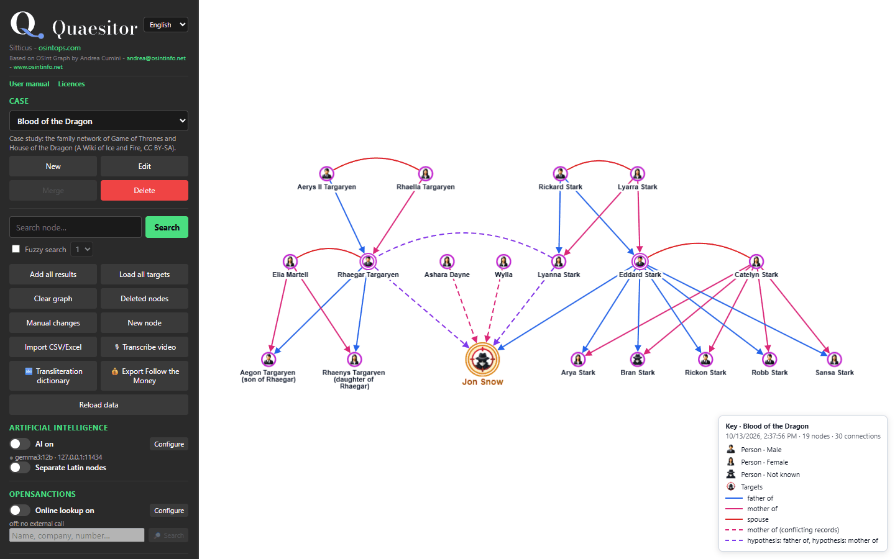

<p align="center">
  <picture>
    <source media="(prefers-color-scheme: dark)" srcset="quaesitor/static/logo.svg">
    
  </picture>
</p>

# Quaesitor 1.10.0


**Quaesitor** is a case graph for OSINT investigations: people, phones, e-mails, social profiles, companies, vehicles, places and documents as an interactive graph, with every case stored on your own computer. It is a fork of [OSInt Graph](https://github.com/tingon11/OsintGraph) by Andrea Cumini (andrea@osintinfo.net, [www.osintinfo.net](https://www.osintinfo.net)): the program, its design, its code and its illustrated manual are his work, released as free software under the GNU GPL v3 with attribution terms. The fork exists because his program was already excellent and only needed adapting to the needs of one analyst — non-Latin names, the Follow the Money data model, the Epieos API, a one-click Windows install and the bridge with Cognitor, the face-recognition program of the same holder. It adds those and nothing else; see [Credits](#credits).

Version 1.10.0, the latest, draws charts by the conventions of link analysis: persons carry their sex (a man, a woman, or the generic person when not known), the **Levels** layout puts each generation or tier on its own row following the arrows, a key on the graph gives the case, the date and the meaning of every colour and line, and the link labels can be hidden. The case study and the screenshots of the manual follow them. Every release, with what it changed, is in the [version history](docs/versionhistory.md).



---

## Key Features

- One archive per case (SQLite), created, merged and deleted from the program.
- Interactive graph: every item is a node, every relation a link; click to expand or collapse, right click for the card, drag and zoom; organic, circular, hierarchical and grid layouts; category filters; saved views.
- Node cards with notes, grouped summary of the connections, raw records, images, one-click copy of every value and PDF export.
- Any kind of node, any node as target, links with a label, a style, a colour and a direction; typed Follow the Money relations (ownership with percentage, directorship with role, payment with amount) on any link.
- Node types for people, phones, e-mails, social profiles, places, vehicles, documents, investigative items (weapons, drugs, cash, cards, wallets, devices, events, property) and the 41 Follow the Money schemata (companies, bank accounts, passports, sanctions, vessels, contracts and so on, 727 fields, labels in five languages). Full catalogue in [docs/ontology.md](docs/ontology.md).
- Non-Latin names: the Latin form is an attribute of the node, so the same person in Cyrillic, Arabic or Chinese and in Latin letters is one node; a switch restores separate twin nodes. Transliteration dictionary window (manual editing, CSV import and export, collection from the graph). Chinese: spaced pinyin, search from two characters, source search on text without spaces. Identity keys that respect Devanagari, Thai and kana with dakuten.
- Import: guided CSV and Excel import with column mapping and preview, unknown columns kept as fields of the card; JSON exports of OSINT tools; Follow the Money datasets (`.json`, `.jsonl`, `.ftm`, up to 200 MB, by upload or by path) with filters, progress and update on re-import; Cognitor case bundles (`.cognitor.zip`) with face photos, co-appearances and video transcripts.
- Export: graph, table and cards to PDF; the case as Follow the Money JSON lines.
- Colour icons for every node type and for the sub-types of drugs, identity, financial and judicial documents and devices (112 icons), generated for this fork; Font Awesome glyphs as fallback.
- Video transcription (optional): transcript, speakers and translation of a video or audio file, on this computer; the video, its speakers and the text enter the graph and the sources.
- Document sources: PDF, Word, Excel, CSV, text and images (OCR with Tesseract) indexed and searchable from the panel or from a card.
- Online lookups, each off by default and confirmed when switched on: OpenSanctions (search, match and import of entities with their relations) and Epieos (reverse lookup of e-mails and phone numbers, paid service, every search confirmed in a dialog with the modules and the remaining credits, responses saved in the case and turned into account, breach, organisation, phone and e-mail nodes, saved responses importable from file without any call).
- Optional AI (Ollama or any OpenAI-compatible server, off by default): free text into proposed nodes, transliteration of names.
- Privacy by design: no account, no telemetry, nothing leaves the machine unless one of the three online features is switched on.
- Six interface languages (Italian, English, French, German, Spanish, Arabic) with a built-in illustrated manual in each.
- Windows scripts to install, start, update and uninstall by double click.

---

## Requirements

- Python 3.10 or newer, on Windows, Linux or macOS.
- A modern web browser. The program serves http://127.0.0.1:5000 and never listens beyond localhost.
- Optional: Tesseract OCR for scanned documents (downloadable from the program on Windows); an Ollama or OpenAI-compatible server for the AI features; API keys for OpenSanctions and Epieos.
- No Internet access is needed to run it. The network is used only by the three online features, each off by default.

## Installation

### Windows

1. Clone or download the repository.
   ```bash
   git clone https://github.com/SOsintOps/quaesitor.git
   ```
2. Double-click **`install.bat`**: it finds Python 3.10+, creates the `.venv` environment, installs the libraries, prepares `chatbot.conf` and `services.conf` from the examples, creates the `sources` folder and asks whether to download Tesseract. It can be run again at any time: it never overwrites configuration or data.
3. Double-click **`start.bat`**: the program starts and the browser opens on http://127.0.0.1:5000. Closing the window stops it.

`update.bat` pulls the repository and updates the libraries; `uninstall.bat` removes `.venv` and the temporary files and asks before touching the cases in `data\`. The program is not "installed" in Windows: it is only this folder.

### Linux

Quaesitor is installed and started for you by the SOsintOps workstations [Argos](https://github.com/SOsintOps/Argos) (Ubuntu Budgie) and [Speculator](https://github.com/SOsintOps/Speculator-Project) (Debian): their installers clone this repository, create the virtual environment, install Tesseract and open the program in the browser. Verified on the Ubuntu 26.04 base of Argos (Python 3.12 and 3.14) and on Debian 13 (Python 3.13). By hand, on Debian or Ubuntu:

```bash
sudo apt install python3-venv tesseract-ocr tesseract-ocr-ita tesseract-ocr-chi-sim tesseract-ocr-rus tesseract-ocr-ara
git clone https://github.com/SOsintOps/quaesitor.git && cd quaesitor
python3 -m venv .venv && .venv/bin/pip install -r requirements.txt
cp chatbot.conf.example chatbot.conf && cp services.conf.example services.conf
DATA_DIR="$HOME/quaesitor-cases" PORT=5000 .venv/bin/python app.py
```

Tesseract is found in the `PATH`; every installed language pack is used for OCR (override with `TESSERACT_LANG=ita+eng`). `DATA_DIR` keeps the cases outside the program folder and `SOURCES_DIR` the documents to index; `PORT` changes the port. Optional: `python3-icu` (ICU transliteration of non-Latin names, picked up when the venv is created with `--system-site-packages`); Ollama, if you want the AI features. No desktop toolkit is needed: without Tkinter the folder picker falls back to a typed path.

### From source, any system

1. Clone the repository and enter the folder.
2. Create and activate a virtual environment: `python -m venv .venv`, then `.venv\Scripts\activate` on Windows or `source .venv/bin/activate` on Linux and macOS.
3. Install the libraries: `pip install -r requirements.txt`.
4. Start it: `python app.py`. The browser opens on http://127.0.0.1:5000; another port with the `PORT` environment variable.

One command per line in PowerShell: `&&` is not accepted there. The Windows single-file executable is built with `python scripts/build_app.py`, after `pip install --group build` (pip 25.1 or newer). Docker is not available yet; see the [roadmap](docs/todo.md).

## Program Sections

The left panel groups everything the program does:

* **Cases**: create, switch, merge and delete the archives; the program starts empty and asks for the first case.
* **Search and graph**: find nodes, expand and collapse, layouts, category filters, saved views.
* **Node card**: notes, connections, raw records, images, OpenSanctions and Epieos buttons, PDF export.
* **New node and links**: every node type, targets, labelled and directed links, Follow the Money relations.
* **Import**: CSV and Excel wizard, JSON exports of OSINT tools, Follow the Money datasets, Cognitor case bundles, Epieos responses.
* **Sources**: indexed documents with OCR, searched from the panel or from a card.
* **Transliteration dictionary**: the Latin forms of non-Latin names, by hand or from the graph.
* **OpenSanctions and Epieos**: online lookups, off by default.
* **AI**: optional server, text into nodes, transliteration.
* **Export**: PDF of graph, table and cards; Follow the Money JSON lines.
* **Transcribe video**: faster-whisper with speakers and translation; optional packages (`requirements-audio.txt`), models downloaded on first use.
* **Help**: the illustrated manual, credits and licences.

---

## Documentation

* [Guidelines](docs/guidelines.md): analytic standards, 5W1H method, OPSEC best practices, writing the report.
* [Intelligence Field Notes](docs/field-notes/README.md): offline copy of the [notes](https://github.com/SOsintOps/intelligence-field-notes) on analytic standards, source evaluation, estimative language and report writing shared by the SOsintOps tools.
* [FAQ](docs/faq.md): the project and its name, licence, installation, data and privacy, AI, Follow the Money, Epieos, non-Latin names, integrations.
* [Link Analysis Guidelines](docs/link-analysis.md): the method behind the graph, from the UNODC manual for analysts, and how each step maps onto the program.
* [Case Study: Blood of the Dragon](docs/case-study-game-of-thrones.md): the method applied end to end to the family network of *Game of Thrones* and *House of the Dragon*, with the import files in `examples/`.
* [Version History](docs/versionhistory.md): full changelog, from the upstream 1.0.0 onward.
* [Ideas & Roadmap](docs/todo.md): what is planned and under consideration.
* [Graph Entities](docs/ontology.md): every node type with its identity rule, fields and Follow the Money equivalent, and the typed relations.

The built-in manual (link **Manuale** in the left panel) covers the interface step by step in all six languages.

---

## Repository

| Path | Contents |
|---|---|
| `app.py` | Starts the program: `python app.py`. |
| `quaesitor/` | The program: the Flask app, `blueprints/` (the routes, one module per area), the shared modules, the archive, the importers, the ontology, `audio/` (video transcription), `templates/` and `static/` (the page, the manual, icons, licences), `generated/` (the Follow the Money ontology, never edited by hand). |
| `tests/`, `scripts/` | The test suite; build, release, licences, icons and Follow the Money tools. |
| `docs/`, `examples/` | Documentation and sample files to import. |
| `*.bat`, `requirements*.txt`, `*.conf.example` | Windows install, start, update and uninstall; the libraries; the settings templates. |
| `pyproject.toml` | Metadata, dependencies, the `audio` extra, the `dev` and `build` dependency groups. |

[Contributing](.github/CONTRIBUTING.md) and the [security policy](.github/SECURITY.md) are in `.github/`.

- `main`: Quaesitor, the branch you install from.
- `osintgraph`: the original program as its author published it (tingon11/OsintGraph, last change on 7 October 2026), never edited, updated only with `git merge upstream/main` (`git remote add upstream https://github.com/tingon11/OsintGraph.git`). It shows where the fork starts. Since 1.8.0 the code of Quaesitor is laid out differently, so upstream changes no longer merge by themselves: they are compared on this branch and carried into `main` by hand.

---

## How to Use Quaesitor

1. Start the program and create a case.
2. Add the subject as target, then the identifiers you hold: names, phones, e-mails, profiles, companies.
3. Import what you already have: a CSV or Excel sheet, the JSON export of another OSINT tool, a Follow the Money dataset, a saved Epieos response.
4. Connect the nodes: solid links for confirmed relations, dashed for suspected ones, an arrow for the direction, the source grade in the label; use the Follow the Money relations for ownership, positions and payments.
5. Read the chart with the questions in the [Link Analysis Guidelines](docs/link-analysis.md), save a view per revision, export the graph and the cards as attachments to the written report.

---

## References

- *Criminal Intelligence: Manual for Analysts* (UNODC, 2011) — [PDF](https://www.azdps.gov/sites/default/files/2023-07/Criminal_Intelligence_Manual_for_Analysts.pdf) | [UN Library Vienna](https://unov.tind.io/record/68083)
- *Follow the Money*, the data model of Aleph and OpenSanctions — [followthemoney.tech](https://followthemoney.tech)
- OpenSanctions API — [opensanctions.org/api](https://www.opensanctions.org/api)
- Epieos — [epieos.com](https://epieos.com)

---

## Contributing

Issues and pull requests are welcome on the SOsintOps repository. Keep changes consistent with the upstream architecture (Flask, vanilla JavaScript, no build step), write documentation in British English under `docs/`, and never commit `chatbot.conf` or `services.conf`. Problems with the fork's additions belong here, not to the original author.

---

## Credits

OSInt Graph is developed and maintained by **Andrea Cumini**: the idea, the design, the code, the manual in six languages are his. His attribution in the interface (the credits line under the logo, the credits window and the licences window) and in the source headers stays, as the licence requires and as is right.

The name "OSInt Graph", its logo and its "OG" icon identify the original program and belong to its author (NOTICE, point 3). They are not distributed with Quaesitor: Quaesitor has a logo and an icon of its own: a Q whose tail ends in a graph node, with the name set in Bodoni Moda. "Quaesitor" is the Latin name of the magistrate who conducted a criminal inquiry.

The Quaesitor fork is developed and maintained by Sitticus (SOsintOps, [osintops.com](https://osintops.com)). The link analysis guidelines are rewritten from the United Nations Office on Drugs and Crime, *Criminal Intelligence: Manual for Analysts* (United Nations, 2011).

---

## Licence

Copyright (C) 2025-2026 Andrea Cumini for OSInt Graph; the fork's additions are released under the same terms. Free software under the [GNU General Public License v3](LICENSE) with additional terms (author attribution, name and logo) in [NOTICE](NOTICE). Third-party libraries, icons and tools keep their own licences, listed in [THIRD-PARTY-NOTICES.md](THIRD-PARTY-NOTICES.md) and readable from the program (link **Licenze**). The names and logos of the social platforms shown next to profiles are trademarks of their respective owners, used only to identify the platform of a profile; this project is not affiliated with any of them.

---

## Disclaimer

Quaesitor is intended for lawful investigations, research and educational use only. It processes personal data collected from open sources: whoever uses it is solely responsible for complying with the laws on data protection and on investigations that apply to them, and with the terms of service of every external service queried. The program is provided without any warranty, and it has no authentication: never expose its port beyond localhost without a proxy with login.
